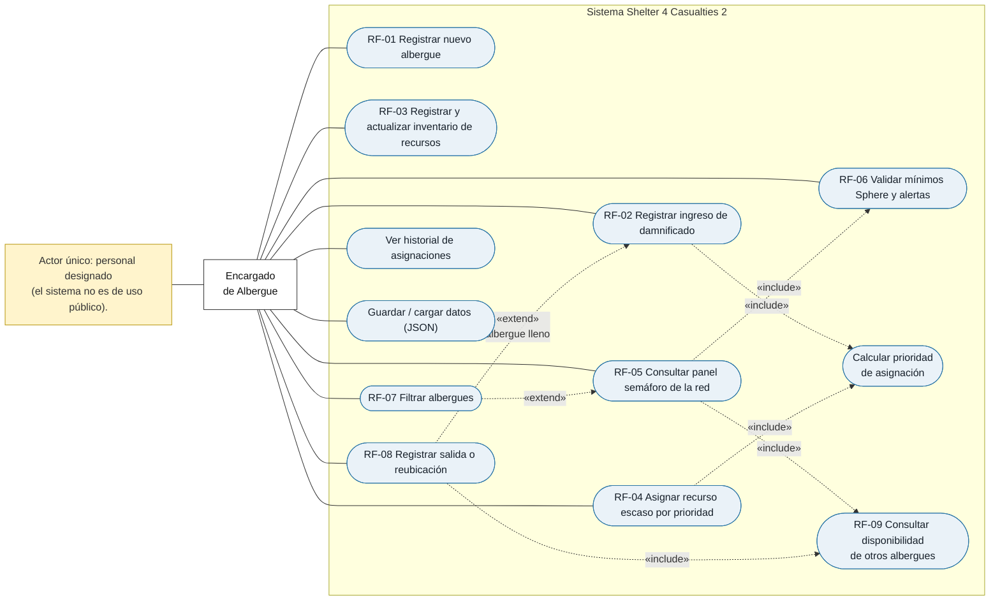

# Diagrama de casos de uso

Actualizado tras la revisión previa a Swing. Cambios respecto a la versión anterior:

- Se agregan los casos que el sistema ya tiene: **ver historial de asignaciones** y **guardar/cargar datos (JSON)**.
- **RF-05** ahora incluye **RF-06** (el semáforo se calcula con los mínimos Sphere).
- La derivación (**RF-08**) extiende **RF-02**: ocurre cuando el albergue elegido está lleno.
- **RF-04** incluye "Calcular prioridad de asignación" (ya existía) y ahora considera el tiempo desde la última entrega.

